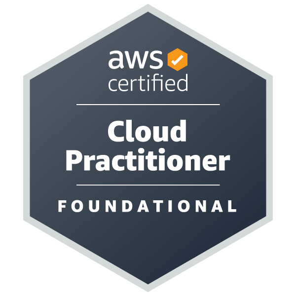

# Hi, I'm Bisola Adebola 👋

### ☁️ Cloud Engineer | AWS Certified Cloud Practitioner | DevOps | DevSecOps | Terraform | Kubernetes | CI/CD | GitOps

**[Verify my AWS certification on Credly](https://www.credly.com/badges/1658cbf6-b19f-4756-b40b-5cd27cd52dfe/public_url)**

I'm a Cloud Engineer transitioning from **8+ years of experience in Human Resources and People Operations** into Cloud Computing, DevOps, and DevSecOps Engineering.

I learn by building hands-on projects that strengthen my skills in cloud infrastructure, Infrastructure as Code (IaC), containerization, CI/CD automation, Kubernetes orchestration, GitOps, and security integration.

My focus is on provisioning infrastructure, deploying applications, automating workflows, troubleshooting systems, and building reliable and secure cloud environments.

I document my projects, challenges, solutions, and lessons learned to demonstrate practical engineering skills and continuous professional development.

---

## 🛠️ Technical Skills

### ☁️ AWS & Cloud Infrastructure
- Amazon EC2, S3, EBS, EFS, and DynamoDB
- VPC, public and private subnets, route tables, and routing
- Internet Gateways and NAT Gateways
- IAM roles, policies, permissions, and access management
- Security Groups and network security
- Application Load Balancer (ALB) and Auto Scaling
- Route 53, DNS, and AWS Certificate Manager (ACM)
- Multi-AZ architecture, high availability, and fault tolerance
- Amazon ECR and AWS CLI
- Cloud infrastructure provisioning and troubleshooting

### 🏗️ Infrastructure as Code (IaC)
- Terraform and AWS provider configuration
- Variables, outputs, resource dependencies, and workspaces
- `terraform init`, `fmt`, `validate`, `plan`, `apply`, and `destroy`
- Terraform state management and resource imports
- S3 remote backend concepts
- Provisioning AWS networking and compute resources
- Terraform workflow automation with GitHub Actions

### 🔄 DevOps & CI/CD
- Git and GitHub
- GitHub Actions workflows
- CI/CD pipeline automation
- YAML configuration and workflow troubleshooting
- Branching, merging, pull requests, and upstream remotes
- Automated Docker image builds and publishing
- Amazon ECR integration
- GitHub repository secrets and environment variables
- Terraform automation and deployment workflows

### 🔐 DevSecOps & Code Quality
- SonarQube setup and integration
- Self-hosted SonarQube using Docker Compose
- Static Application Security Testing (SAST) fundamentals
- Automated source code quality analysis
- SonarQube scanner configuration
- GitHub Actions and SonarQube integration
- Token and server URL configuration
- Secure CI/CD secrets management
- Troubleshooting YAML, source paths, and pipeline failures

### 🐳 Containers
- Docker and Docker Compose
- Container images, builds, and runtime management
- Multi-container application deployment
- Amazon ECR image registry
- Portainer Community Edition
- Containerized frontend and backend applications
- Running self-hosted services on AWS EC2

### ☸️ Kubernetes & Orchestration
- Kubernetes and K3s
- Multi-node cluster architecture
- Control-plane and worker nodes
- Pods, ReplicaSets, Deployments, and StatefulSets
- ClusterIP and NodePort Services
- Kubernetes manifests and YAML
- PersistentVolumes (PV), PersistentVolumeClaims (PVC), and StorageClasses
- Amazon EFS storage integration fundamentals
- Workload deployment and troubleshooting
- Pod scheduling, node connectivity, and container failures

### 🚀 GitOps & Continuous Delivery
- Argo CD installation and configuration
- Connecting GitHub repositories to Argo CD
- Declarative Kubernetes application management
- Git-based deployment workflows
- Application synchronization and desired-state reconciliation
- Version-controlled Kubernetes manifests

### 🐧 Linux, Networking & Technical Support
- Ubuntu Linux and command-line fundamentals
- SSH and remote server administration
- File permissions and directory management
- TCP/IP, IP addressing, CIDR, and subnetting
- DNS, routing, ports, and connectivity troubleshooting
- Linux-based application deployment
- Log analysis and systematic troubleshooting
- Technical documentation and incident investigation

### 📊 Monitoring & Observability
- Datadog monitoring fundamentals
- Infrastructure and application monitoring
- Slack alert notification concepts
- Troubleshooting and root-cause investigation
- High availability and reliability fundamentals

### 💻 Supporting Technologies
- Java Spring Boot
- MongoDB Atlas
- Nginx
- Visual Studio Code
- MobaXterm
- GitHub Desktop
- OpenLens
- AWS Management Console

---

## 🚀 Featured Cloud, DevOps & DevSecOps Projects

### 1. 🔐 SonarQube Integration with GitHub Actions

Integrated source code quality analysis into a GitHub Actions workflow using SonarQube, focusing on CI/CD configuration and troubleshooting.

**Technologies:** SonarQube | Docker Compose | GitHub Actions | YAML | CI/CD | GitHub Secrets

**Key learning outcomes:**
- Configuring SonarQube for source code analysis
- Connecting a repository to SonarQube
- Configuring server URLs and authentication tokens
- Investigating failed GitHub Actions workflows
- Troubleshooting YAML configuration and source paths
- Integrating automated code analysis into development workflows

🔗 **Repository:** Add your SonarQube repository URL here.

### 2. 🏗️ Terraform AWS VPC Infrastructure

Provisioned AWS networking and compute resources using Terraform and Infrastructure as Code principles.

**Technologies:** Terraform | AWS | VPC | Subnets | NAT Gateways | Route Tables | Security Groups | EC2

**Key learning outcomes:**
- Defining infrastructure through Terraform
- Configuring public and private subnets across Availability Zones
- Managing resource dependencies and Terraform state
- Planning infrastructure changes and troubleshooting deployments

🔗 [View Terraform Project](https://github.com/bisolaadebola/terraform-aws-vpc-infrastructure)

### 3. ☸️ Argo CD GitOps Deployment

Installed and configured Argo CD in a Kubernetes environment and connected it to GitHub for GitOps-based application management.

**Technologies:** Argo CD | Kubernetes | GitHub | GitOps | YAML | AWS EC2

**Key learning outcomes:**
- Installing Argo CD
- Connecting Git repositories to Argo CD
- Managing Kubernetes manifests through Git
- Understanding declarative delivery and reconciliation
- Configuring external access to the Argo CD server

🔗 [View Argo CD Project](https://github.com/bisolaadebola/argocd-gitops-deployment)

### 4. ☸️ Multi-Node Kubernetes Cluster with K3s

Built a Kubernetes cluster consisting of one control-plane node and three worker nodes.

**Technologies:** K3s | Kubernetes | Linux | Ubuntu | Portainer | AWS EC2

**Key learning outcomes:**
- Installing and configuring a multi-node cluster
- Joining worker nodes to the control plane
- Deploying and managing workloads
- Investigating pod scheduling and container startup issues
- Documenting installation and troubleshooting procedures

🔗 [View K3s Project](https://github.com/bisolaadebola/k3s-multinode-kubernetes-aws)

### 5. ☁️ Highly Available Web Application Infrastructure on AWS

Built highly available web infrastructure using AWS compute, networking, load balancing, and storage services.

**Technologies:** AWS | EC2 | VPC | EFS | EBS | ALB | Auto Scaling | Route 53 | ACM | Datadog

**Key learning outcomes:**
- Designing infrastructure across Availability Zones
- Configuring load balancing and Auto Scaling
- Exploring shared storage and persistent data
- Configuring DNS and HTTPS
- Applying monitoring and high-availability concepts

🔗 [View High Availability Project](https://github.com/bisolaadebola/BFitHub-AWS-High-Availability)

### 6. 🎬 Dynamic Full-Stack Movie Web Application

Deployed a dynamic movie application using Docker containers and an automated build-and-deployment workflow.

**Technologies:** Docker | GitHub Actions | Amazon ECR | AWS EC2 | Java Spring Boot | MongoDB Atlas | Portainer

**Key learning outcomes:**
- Containerizing application components
- Automating image builds with GitHub Actions
- Publishing images to Amazon ECR
- Deploying containers to an AWS-hosted server
- Working with frontend, backend, and database components

🔗 [View Frontend Repository](https://github.com/bisolaadebola/netflix-movie-frontend)

### 7. ☸️ Kubernetes Manifests & Workload Management

Practised declarative Kubernetes resource management using YAML manifests for workloads, networking, and persistent storage.

**Technologies:** Kubernetes | YAML | Pods | Deployments | ReplicaSets | StatefulSets | Services | PVC | EFS

**Key learning outcomes:**
- Defining resources declaratively
- Understanding workload controllers and service discovery
- Exposing applications through Services
- Exploring persistent storage configurations
- Troubleshooting manifest and workload errors

🔗 [View Kubernetes Manifest Project](https://github.com/bisolaadebola/kubernetes-manifest)

### 8. 🛍️ E-Commerce DevSecOps Platform

Exploring a DevSecOps workflow for a containerized e-commerce application, with an emphasis on code quality, security integration, and automated delivery.

**Technologies:** Docker | Kubernetes | GitHub Actions | SonarQube | Terraform | YAML | CI/CD

**Learning objectives:**
- Integrating code analysis into development workflows
- Exploring security checks for application source code
- Managing microservice deployment configurations
- Troubleshooting CI/CD failures
- Applying secure development and infrastructure automation practices

*Project status: In progress.*

🔗 Add your e-commerce repository URL here.

---

## 📜 Certifications & Professional Development

### 🏆 Certifications
- **AWS Certified Cloud Practitioner (CLF-C02)** — Amazon Web Services  
  [Verify my certification on Credly](https://www.credly.com/badges/1658cbf6-b19f-4756-b40b-5cd27cd52dfe/public_url)
- **People Analytics Certificate** — Wharton, University of Pennsylvania (2025)

### 📚 Technical Training
- AWS Cloud Technical Essentials
- Technical Support Fundamentals

### 🌱 Continuous Learning
I continue to expand my skills in cloud architecture, security, Terraform, Kubernetes, DevSecOps, CI/CD automation, monitoring, and troubleshooting through practical projects and continuous learning.

---

## 🎯 Career Focus

I'm interested in opportunities in:

- Cloud Engineering
- AWS Cloud Support and Cloud Operations
- DevOps Engineering
- DevSecOps Engineering
- Infrastructure Engineering
- Junior Platform Engineering
- Site Reliability Engineering (SRE)

My background in Human Resources and People Operations brings additional strengths in communication, collaboration, coordination, documentation, and problem-solving.

I'm open to opportunities where I can contribute my practical cloud and automation skills while learning from experienced engineering teams.

---

## 🌱 My Approach to Learning

**I learn by building, troubleshooting, and documenting.**

I use hands-on projects to provision infrastructure, deploy applications, automate workflows, investigate failures, and document technical solutions.

I believe that understanding how systems work—and knowing how to investigate when something goes wrong—is essential to becoming a capable Cloud and DevOps Engineer.

---

## 📫 Connect With Me

- **LinkedIn:** [linkedin.com/in/bisolaadebola-acipm](https://www.linkedin.com/in/bisolaadebola-acipm)
- **GitHub:** [github.com/bisolaadebola](https://github.com/bisolaadebola)
- **AWS Certification:** [Verify on Credly](https://www.credly.com/badges/1658cbf6-b19f-4756-b40b-5cd27cd52dfe/public_url)

---

### ☁️ Building. Deploying. Automating. Securing. Learning.
